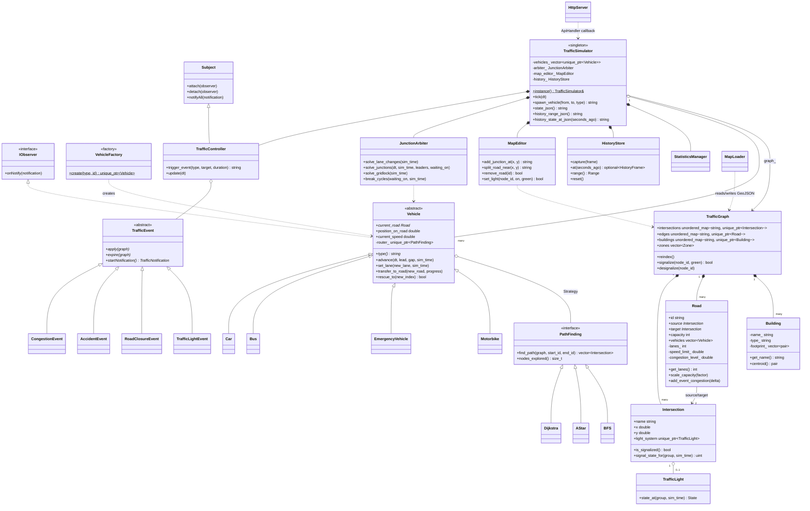

# Architecture

This document describes the C++ simulation engine in `cpp_backend/`, organised
by the five component categories the assignment brief asks for (§7: Graph,
Vehicle, Algorithm, Simulation, Utility), and the design pattern each class
demonstrates. It reflects the code as it stands after the full OOP hardening
pass (RAII ownership, encapsulation, and the `TrafficSimulator` split) — see
`docs/PLAN-oop-hardening.md` for the reasoning behind each change.

## Graph component

**`TrafficGraph`** (`core/Graph.hpp`) is the road network: three owning maps
keyed by id (`intersections`, `edges`, `buildings`) plus a vector of display-only
`Zone`s. Ownership is `unique_ptr` all the way down — `TrafficGraph` follows
the Rule of Zero (its destructor is compiler-generated; the `unique_ptr`s free
themselves), copying is explicitly deleted (a graph owns its nodes/edges, so a
shallow copy would double-free and nothing needs a deep one), and moving is
allowed and used by `load()`/`import_map()`. `reindex()` assigns dense integer
ids (`Intersection::index`, `Road::index`/`base_index`) that back the O(1)
lookups `JunctionArbiter` needs on the hot tick path.

**`Intersection`** is a graph node: position, the roads meeting there
(`outgoing_edges`/`incoming_edges`), and an optional `unique_ptr<TrafficLight>`.
`is_signalized()` is *derived* from `light_system != nullptr` rather than a
separately-stored bool — one source of truth instead of two fields that could
disagree.

**`Road`** is a directed edge with a `source`/`target` `Intersection*` pair.
Fields split two ways: pure topology/geometry (`id`, `capacity`, `is_one_way`,
`length`, `geometry`, `vehicles`, ...) stay public because they're read
constantly on the simulation hot path and carry no invariant to protect;
fields with a real invariant (`lanes_`, `speed_limit_`, `congestion_level_`,
`is_closed_`, `capacity_scale_`, `event_congestion_`) are private behind
getters and semantic setters — `scale_capacity(factor)` (multiplicative) and
`add_event_congestion(delta)` (additive), matching how overlapping
`TrafficEvent`s actually need to compose (two accidents on the same road stack
and unwind independently).

**`Building`** anchors a name/type/footprint to an optional `Intersection`
node; fully encapsulated (no external code touches its fields directly, all
access goes through getters and `set_node_id()`).

**`Zone`** (`core/Zone.hpp`) is a display-only bounding box (downtown, a
roundabout's interior, ...) with no simulation behaviour of its own.

## Vehicle component

**`Vehicle`** (`vehicles/Vehicle.hpp`) is abstract and implements `IObserver`
(Observer pattern — see Utility below): a vehicle is told about road closures,
accidents and congestion on roads still ahead of it, and flags itself for a
reroute rather than reacting mid-notification. It owns a `PathFinding*`
through the Strategy pattern (see Algorithm below) and exposes the physics the
simulator drives every tick: `advance()` (IDM car-following + signal
compliance), `set_lane()` (MOBIL lane changes), `transfer_to_road()` (survives
a live map edit), `rescue_to()` (gridlock relief). Encapsulation here follows
the same measure-first rule as `Road`: `current_road`, `position_on_road` and
`current_speed` stay public — they're rewritten every tick by the simulator's
solver *and* poked directly by test scaffolding to rig physics scenarios,
exactly like `Road`'s hot-path fields. `destination`, `max_speed`,
`accel`/`max_accel`/`max_decel`, `route`/`route_index`, `travel_history` and
`is_reached_destination` had zero-to-single-digit external touch points, so
they sit behind the getters that (mostly) already existed.

`idm_accel()`'s constants are retuned tighter than textbook IDM on purpose
(this sim reads as dense urban traffic, not an open highway), and it also
gains a term textbook IDM doesn't have at all: ordinary IDM only reacts to a
gap that is already tight, so two vehicles that reach the same speed with
room to spare just hold whatever gap they happened to spawn with, forever.
A bounded "close up" term raises the free-flow speed ceiling while there's
slack worth taking up — real drivers tuck in behind the car ahead because
there's room, not because they're forced to — and hands back off to the
ordinary braking term as the gap closes, so it never weakens the
collision-avoidance guarantee it's layered on top of.

**`Car` / `Bus` / `EmergencyVehicle` / `Motorbike`** (`vehicles/VehicleTypes.hpp`,
all `final`) override `Vehicle`'s virtual hooks — `speed_factor()`,
`length_meters()`, `congestion_sensitivity()`, `ignores_lights()`,
`lane_politeness()`, `allowed_lanes()` — to express one behavioural
difference each (a bus keeps out of the fast lane, an ambulance ignores red
lights and never yields lane space) rather than branching on a type enum
anywhere else in the codebase.

**`VehicleFactory`** (Factory pattern) is the one place that names `Car`,
`Bus`, `EmergencyVehicle` or `Motorbike` directly; `TrafficSimulator` asks it
for a vehicle by type string and never `new`s a concrete class itself.

## Algorithm component

**`PathFinding`** (`routing/PathFinding.hpp`) is the Strategy interface:
`find_path(graph, start_id, end_id)`. **`Dijkstra`**, **`AStar`** and
**`BFS`** (all `final`) are interchangeable implementations, swapped per
vehicle at runtime via `Vehicle::set_algorithm()` — the vehicle holds the
strategy object and calls through the base class, so changing algorithms
swaps an object rather than adding a branch to an if-chain. `nodes_explored()`
is tracked on the base class so `StatisticsManager` can compare algorithms
without each one re-implementing the counter.

## Simulation component

**`TrafficSimulator`** (Singleton — `instance()`) drives the world: the
five-phase tick loop (events/lanes → leads/physics → cleanup/spawn →
statistics → history capture), vehicle spawn/despawn, and state
serialization (`state_json()`/`encode_binary_snapshot()`, each published on
its own cadence to a lock-free snapshot so HTTP reads never block a tick).
It no longer does everything itself — three responsibilities that used to
live in its 1600-line `.cpp` file now have their own classes:

- **`JunctionArbiter`** owns the per-tick traffic solver: MOBIL lane changes
  (`solve_lane_changes`), right-of-way at unsignalized junctions
  (`solve_junctions`), and gridlock detection/relief (`break_cycles`,
  `solve_gridlock`, plus the free function `find_gridlock_cycle_leaders`,
  which finds cycles in the wait-for graph independently of everything else
  and is unit-tested directly for exactly that reason).
- **`MapEditor`** owns live map editing — adding/removing junctions, roads and
  buildings, splitting a road under moving traffic while keeping every
  vehicle on it in place, retuning a road or a light.
- **`HistoryStore`** owns playback history: one frame of the world captured
  per REAL second (not `sim_time_`, which resets to 0 on every `load()` and
  would let two different real moments claim the same "t" — see its own
  header comment), written to hourly segment files under `data/history/` so
  a client can scrub back through the last 24h without the live simulation
  ever pausing. Delta-encodes road congestion between frames rather than
  repeating an unchanged value every second. `reset()` — called once from
  `start_publishing()` — deletes whatever a *previous* run of the simulator
  left on disk first: playback history belongs to the run that produced it,
  it does not carry across a restart.

`JunctionArbiter` and `MapEditor` are handed references to the graph
pointer, the vehicle fleet and the event controller rather than owning them
(vehicle lifetime and the graph pointer stay `TrafficSimulator`'s call), and
`TrafficSimulator`'s own methods of the same names become one-line
forwarders — nothing calling the simulator today had to change. Splitting
them out is a Single Responsibility Principle change with no behavioural
difference, matching the assignment's own suggested split of "Simulation"
into cooperating components. `HistoryStore` follows a looser version of the
same idea but doesn't hold any of those references itself — it knows
nothing about `TrafficGraph`/`Vehicle`/`TrafficController` at all;
`tick_history_capture()` reads them and hands `HistoryStore::capture()` a
self-contained snapshot struct instead, which is what keeps the persistence
format decoupled from the live simulation's own types.

**`TrafficController`** owns the live `TrafficEvent`s and is the Observer
*Subject* every `Vehicle` attaches to — the simulator moves vehicles, the
controller decides what happens to the network, and the two talk only through
`TrafficNotification`s.

**`TrafficEvent`** (abstract) is the hierarchy behind random and API-triggered
events: **`CongestionEvent`**, **`AccidentEvent`**, **`RoadClosureEvent`** and
**`TrafficLightEvent`** (all `final`) each know how to `apply()` themselves to
the graph, `expire()` (undo) when their duration runs out, and which
`TrafficNotification` to broadcast on each transition — one description of
what an event means, not a description plus a separate undo path that could
drift from it. `makeEvent()` is the matching Factory.

## Utility component

**`Observer`** (`utils/Observer.hpp`) supplies `IObserver`/`Subject`, used by
`Vehicle`/`TrafficController` above.

**`StatisticsManager`** aggregates travel metrics (completed trips, average
time/length), algorithm metrics (per-algorithm computation time and node
counts, for comparing `Dijkstra`/`AStar`/`BFS` head to head), and a rolling
traffic-density history sampled every couple of simulated seconds.

**`MapLoader`** parses/writes the GeoJSON map format (nodes, roads, buildings,
zones, signal timings) and validates an imported map before it replaces the
running one. It also imports directly from raw OpenStreetMap data: a real
`highway=traffic_signals` node sits a few metres before the junction it
governs, on the approach road, not on the junction itself, so signalizing a
junction from OSM is a bounded walk from each signal vertex to the nearest
real junction ahead rather than a direct id lookup — the arm the walk
travels into is the one the signal actually controls.

**`HttpServer`** (`server/WebSocketServer.hpp` — named for history, it speaks
plain HTTP) is a small, dependency-free HTTP/1.1 server: it serves the static
frontend and forwards `/api/...` requests to an `ApiHandler` callback wired up
in `main.cpp`, keeping the transport layer independent of what the API
actually does.

## Class diagram

