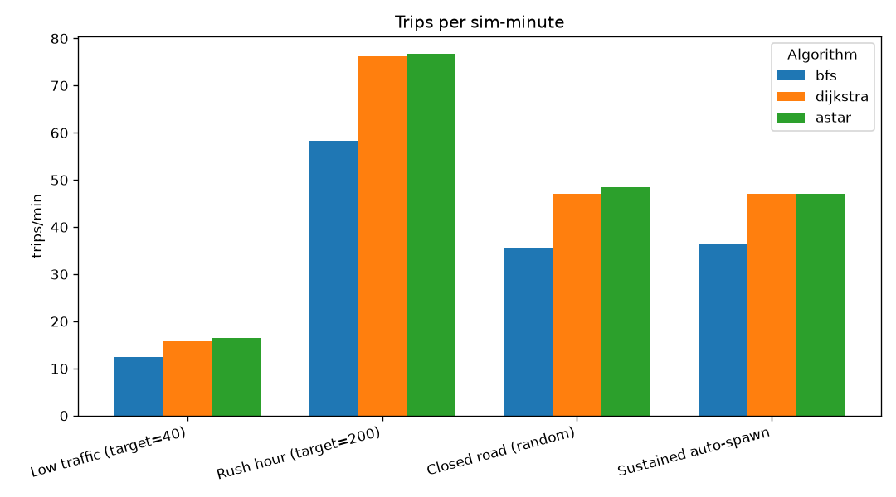
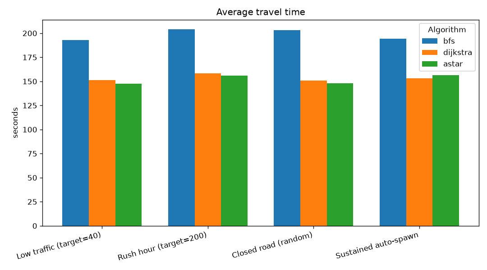
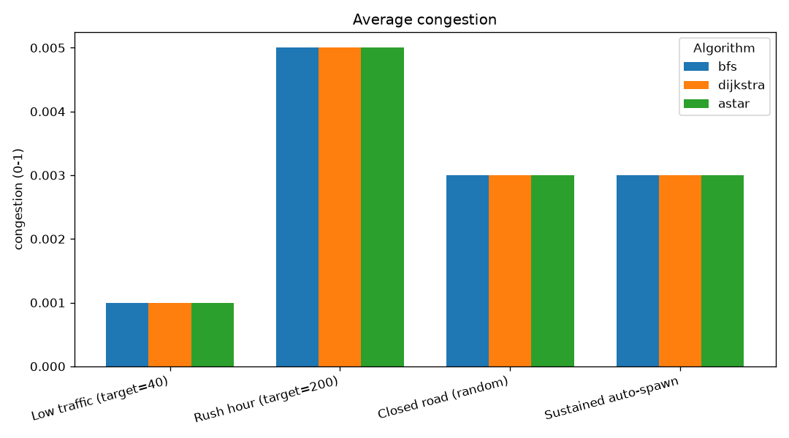
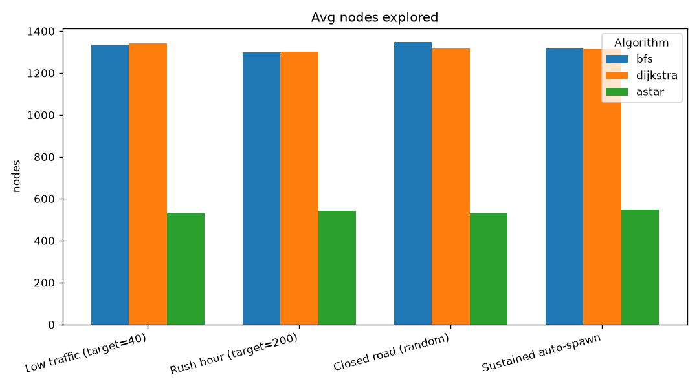
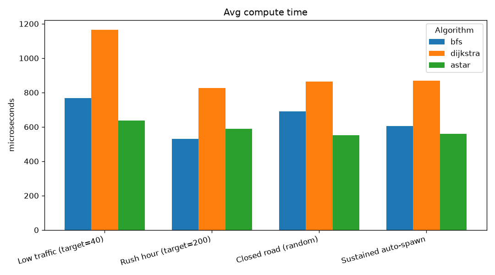
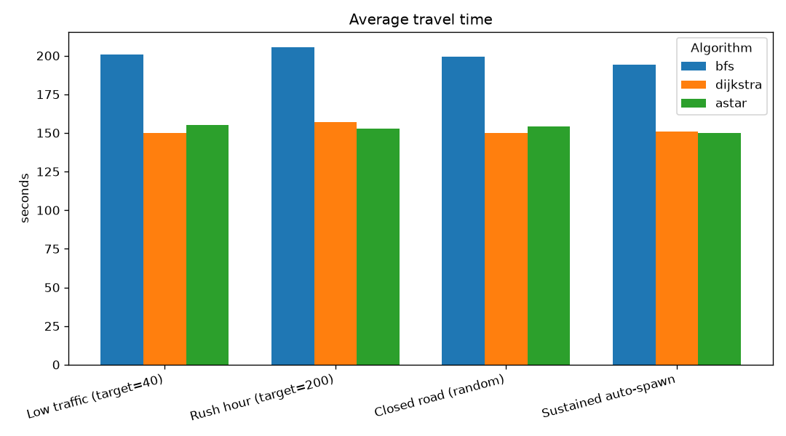
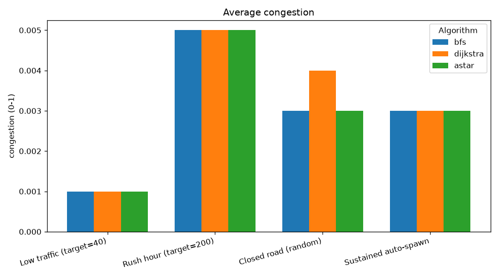
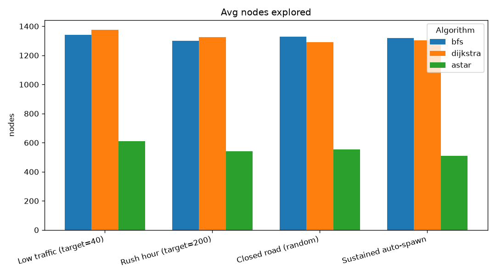
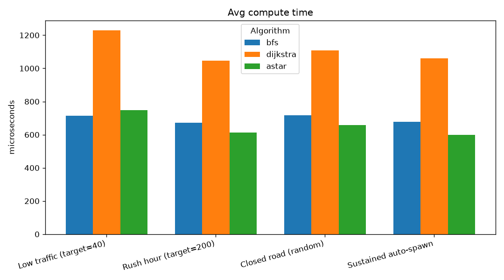

# Output from tools/route_bench.cpp:
```
[map] pruned 202 node(s) outside the largest connected road network (kept 2617)
[map] signalized 3 junction(s) from OSM traffic_signals (9 skipped: nothing to arbitrate)
map           : data\maps\small_map.geojson
graph         : 2617 intersections, 6097 roads
pairs         : 100 attempted, 100 solved by all three

Algorithm    Solved  Nodes/route    Time (us)     Route cost      Roads
----------   ------  -----------    ---------     ----------      -----
BFS             100       1406.5        450.3          157.8       36.0
Dijkstra        100       1363.8        672.2          116.8       42.0
A*              100        518.7        405.5          116.8       42.0

--- What the table shows ---
A* == Dijkstra cost : 100 / 100 pairs   (admissible heuristic => optimal)
A* search effort    : 38.0% of Dijkstra's nodes
BFS route cost      : 135.1% of Dijkstra's   (more expensive: BFS counts roads, not weight)
```
- Note that us here means microseconds.
- Explaination : #TODO


## 2026-08-02 20:05

Four scenarios x three algorithms (3 repeats per combo, mean ± range); each run advanced 300 s of simulated time (x10 speed) after a warm-up, routing by time cost. Closure picks a random road each run.

### Results

| Scenario | Algorithm | Trips/min | Travel (s) | Congestion | Recomp/min | Active | Nodes/recomp | Micros/recomp |
|---|---|---|---|---|---|---|---|---|
| Low traffic (target=40) | bfs | 12.37 ± 0.73 | 192.71 ± 19.71 | 0.001 | 12.37 ± 0.73 | 40.0 | 1337.133 ± 91.9 | 767.633 ± 60.9 |
| Low traffic (target=40) | dijkstra | 15.71 ± 0.99 | 151.353 ± 13.32 | 0.001 | 15.71 ± 0.99 | 40.0 | 1341.467 ± 49.9 | 1164.0 ± 59.4 |
| Low traffic (target=40) | astar | 16.5 ± 1.25 | 147.753 ± 8.86 | 0.001 | 16.5 ± 1.25 | 40.0 | 531.367 ± 105.2 | 636.167 ± 152.9 |
| Rush hour (target=200) | bfs | 58.35 ± 1.35 | 203.92 ± 6.31 | 0.005 | 58.51 ± 1.23 | 200.0 | 1300.1 ± 29.9 | 531.6 ± 47.8 |
| Rush hour (target=200) | dijkstra | 76.25 ± 2.13 | 158.127 ± 9.08 | 0.005 | 76.953 ± 1.85 | 200.0 | 1302.333 ± 29.8 | 825.767 ± 18.1 |
| Rush hour (target=200) | astar | 76.667 ± 2.43 | 156.023 ± 5.33 | 0.005 | 77.213 ± 2.55 | 200.0 | 543.867 ± 45.6 | 588.433 ± 173.7 |
| Closed road (random) | bfs | 35.713 ± 2.0 | 203.103 ± 21.44 | 0.003 | 35.913 ± 2.12 | 120.0 | 1346.667 ± 87.6 | 690.7 ± 218.8 |
| Closed road (random) | dijkstra | 47.08 ± 2.12 | 150.883 ± 5.1 | 0.003 ± 0.001 | 47.293 ± 2.0 | 120.0 | 1316.733 ± 20.9 | 862.6 ± 21.4 |
| Closed road (random) | astar | 48.42 ± 1.48 | 148.18 ± 2.22 | 0.003 | 48.667 ± 1.24 | 120.0 | 531.0 ± 16.1 | 552.033 ± 102.3 |
| Sustained auto-spawn | bfs | 36.253 ± 2.71 | 194.15 ± 22.84 | 0.003 | 36.333 ± 2.71 | 120.0 | 1315.733 ± 60.6 | 605.133 ± 96.3 |
| Sustained auto-spawn | dijkstra | 47.113 ± 3.79 | 153.15 ± 10.94 | 0.003 | 47.54 ± 4.17 | 120.0 | 1314.4 ± 104.4 | 868.4 ± 79.9 |
| Sustained auto-spawn | astar | 47.047 ± 4.06 | 156.5 ± 4.81 | 0.003 ± 0.001 | 47.253 ± 4.31 | 120.0 | 548.6 ± 1.2 | 558.3 ± 101.7 |

### Charts












## 2026-08-02 20:35

Four scenarios x three algorithms (3 repeats per combo, mean ± range); each run advanced 300 s of simulated time (x10 speed) after a warm-up, routing by time cost. Closure picks a random road each run.

### Results

| Scenario | Algorithm | Trips/min | Travel (s) | Congestion | Recomp/min | Active | Nodes/recomp | Micros/recomp |
|---|---|---|---|---|---|---|---|---|
| Low traffic (target=40) | bfs | 11.627 ± 0.87 | 200.657 ± 23.41 | 0.001 | 11.667 ± 0.87 | 40.0 | 1340.4 ± 61.5 | 713.667 ± 187.9 |
| Low traffic (target=40) | dijkstra | 15.517 ± 0.91 | 150.1 ± 7.92 | 0.001 | 15.517 ± 0.91 | 40.0 | 1374.5 ± 64.5 | 1228.167 ± 100.9 |
| Low traffic (target=40) | astar | 15.863 ± 0.88 | 155.067 ± 0.42 | 0.001 | 15.863 ± 0.88 | 40.0 | 610.7 ± 3.1 | 746.767 ± 104.2 |
| Rush hour (target=200) | bfs | 58.73 ± 3.05 | 205.263 ± 6.92 | 0.005 | 59.15 ± 3.67 | 200.0 | 1301.2 ± 40.1 | 673.167 ± 141.5 |
| Rush hour (target=200) | dijkstra | 75.76 ± 4.91 | 156.79 ± 8.11 | 0.005 ± 0.001 | 76.447 ± 4.64 | 200.0 | 1323.867 ± 76.1 | 1047.5 ± 78.7 |
| Rush hour (target=200) | astar | 77.89 ± 2.39 | 152.783 ± 2.75 | 0.005 | 78.317 ± 1.49 | 200.0 | 540.533 ± 50.2 | 612.0 ± 130.2 |
| Closed road (random) | bfs | 36.21 ± 1.25 | 199.487 ± 4.39 | 0.003 | 36.297 ± 1.38 | 120.0 | 1329.4 ± 32.4 | 717.767 ± 88.1 |
| Closed road (random) | dijkstra | 47.657 ± 1.16 | 150.01 ± 3.23 | 0.004 ± 0.001 | 47.827 ± 1.04 | 120.0 | 1289.333 ± 19.7 | 1108.267 ± 106.6 |
| Closed road (random) | astar | 45.367 ± 2.53 | 154.35 ± 4.95 | 0.003 | 45.45 ± 2.4 | 120.0 | 555.067 ± 73.7 | 658.5 ± 121.6 |
| Sustained auto-spawn | bfs | 36.88 ± 1.26 | 194.2 ± 11.49 | 0.003 | 37.09 ± 1.27 | 120.0 | 1318.5 ± 71.0 | 677.4 ± 27.4 |
| Sustained auto-spawn | dijkstra | 47.243 ± 2.93 | 150.73 ± 9.51 | 0.003 | 47.503 ± 3.19 | 120.0 | 1304.3 ± 35.8 | 1060.133 ± 60.6 |
| Sustained auto-spawn | astar | 47.953 ± 1.38 | 149.963 ± 9.46 | 0.003 | 48.123 ± 1.51 | 120.0 | 508.9 ± 20.2 | 598.767 ± 33.3 |

### Charts











