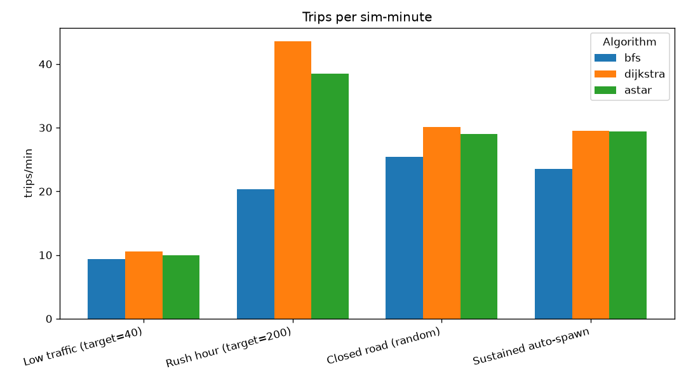
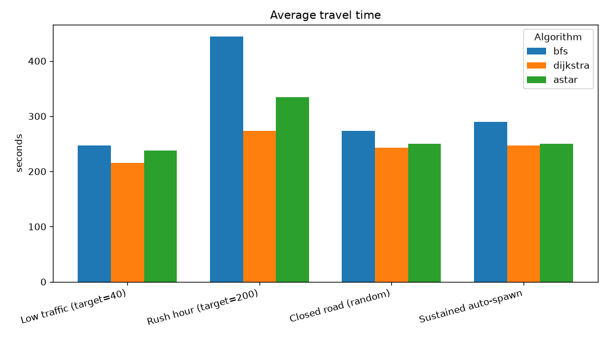
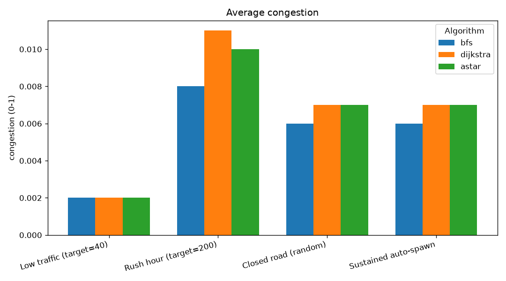
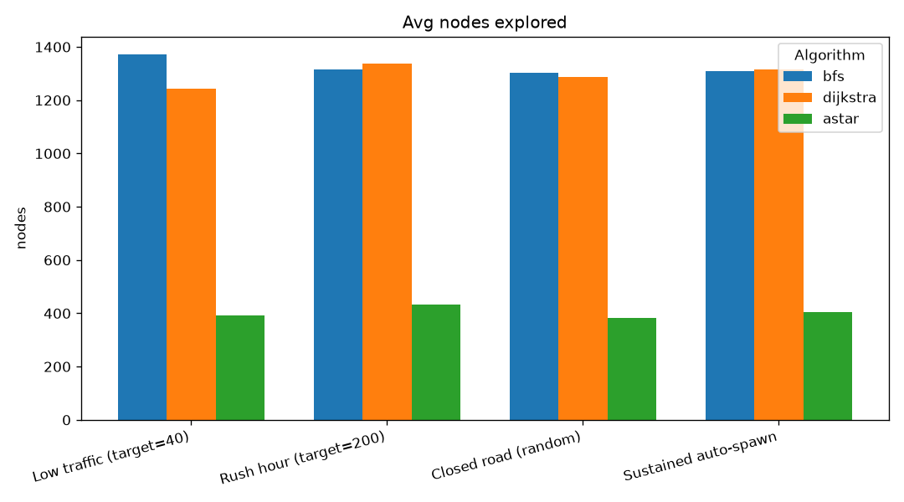
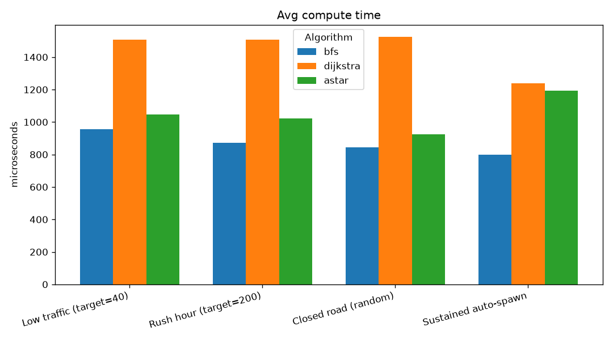
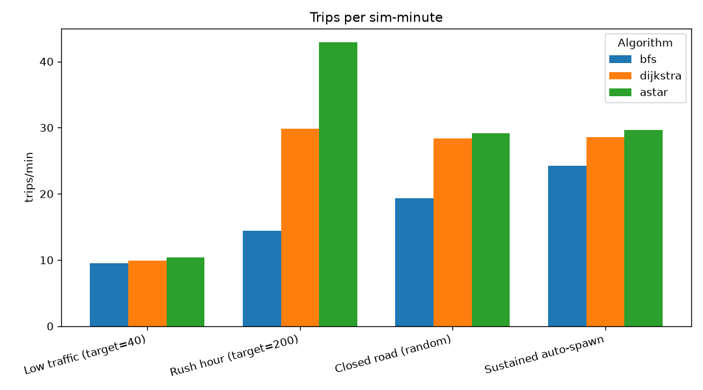
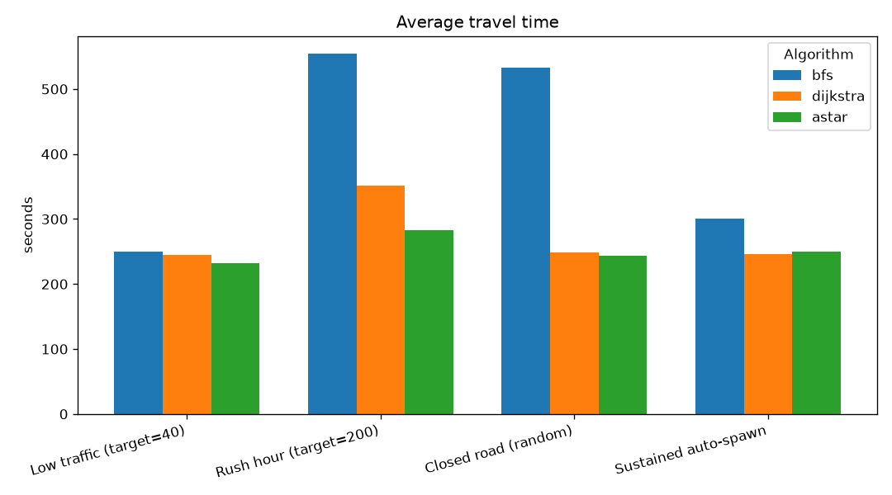
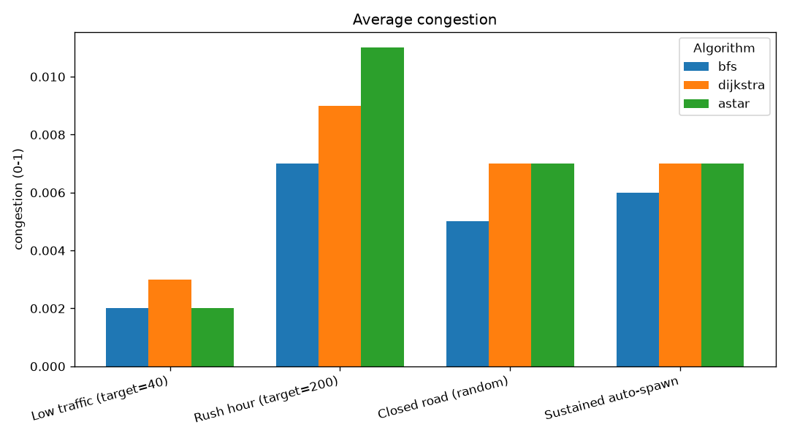
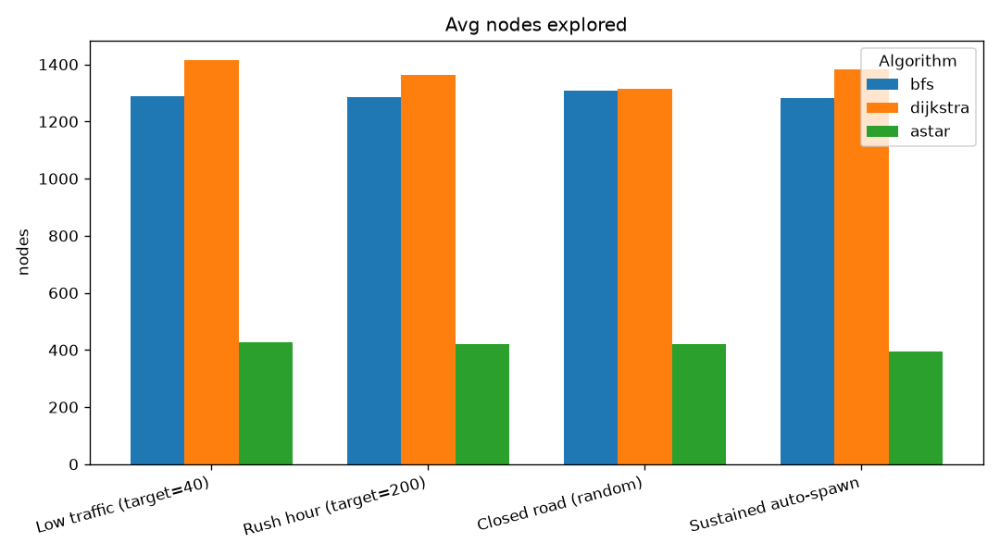
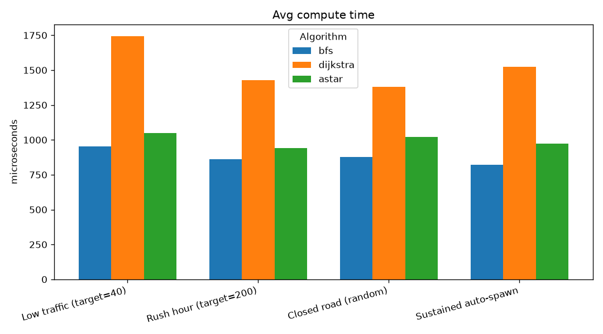

# Output from tools/route_bench.cpp:
```
[map] pruned 202 node(s) outside the largest connected road network (kept 2617)
[map] signalized 3 junction(s) from OSM traffic_signals (9 skipped: nothing to arbitrate)
map           : data\maps\small_map.geojson
graph         : 2617 intersections, 6097 roads
pairs         : 100 attempted, 100 solved by all three

Algorithm    Solved  Nodes/route    Time (us)     Route cost      Roads
----------   ------  -----------    ---------     ----------      -----
BFS             100       1406.5        926.6         1579.4       36.0
Dijkstra        100       1385.4       1581.9         1410.6       41.6
A*              100        377.9       1069.0         1410.6       41.6

--- What the table shows ---
A* == Dijkstra cost : 100 / 100 pairs   (admissible heuristic => optimal)
A* search effort    : 27.3% of Dijkstra's nodes
BFS route cost      : 112.0% of Dijkstra's   (more expensive: BFS counts roads, not weight)
```
- Note that us here means microseconds.
- Explaination : #TODO


## 2026-08-02 12:40

Four scenarios x three algorithms (3 repeats per combo, mean ± range); each run advanced 300 s of simulated time (x10 speed) after a warm-up. Closure picks a random road each run.

### Results

| Scenario | Algorithm | Trips/min | Travel (s) | Congestion | Recomp/min | Active | Nodes/recomp | Micros/recomp |
|---|---|---|---|---|---|---|---|---|
| Low traffic (target=40) | bfs | 9.33 ± 0.15 | 246.85 ± 33.88 | 0.002 | 9.33 ± 0.15 | 40.0 | 1370.6 ± 138.7 | 956.133 ± 109.5 |
| Low traffic (target=40) | dijkstra | 10.51 ± 1.59 | 215.893 ± 13.42 | 0.002 ± 0.001 | 10.59 ± 1.47 | 40.0 | 1244.033 ± 121.6 | 1506.4 ± 89.3 |
| Low traffic (target=40) | astar | 9.967 ± 0.1 | 237.677 ± 13.84 | 0.002 | 9.967 ± 0.1 | 40.0 | 393.0 ± 70.6 | 1047.367 ± 36.2 |
| Rush hour (target=200) | bfs | 20.34 ± 12.65 | 443.843 ± 234.08 | 0.008 ± 0.002 | 20.587 ± 12.65 | 200.0 | 1316.167 ± 105.9 | 873.233 ± 120.5 |
| Rush hour (target=200) | dijkstra | 43.533 ± 3.83 | 273.43 ± 22.31 | 0.011 ± 0.001 | 43.967 ± 4.1 | 200.0 | 1337.9 ± 42.2 | 1506.0 ± 303.0 |
| Rush hour (target=200) | astar | 38.447 ± 15.16 | 334.847 ± 174.64 | 0.01 ± 0.002 | 38.697 ± 14.79 | 200.0 | 432.833 ± 23.7 | 1020.967 ± 53.9 |
| Closed road (random) | bfs | 25.443 ± 1.35 | 273.653 ± 12.23 | 0.006 ± 0.002 | 25.53 ± 1.35 | 120.0 | 1303.567 ± 21.9 | 844.033 ± 34.4 |
| Closed road (random) | dijkstra | 30.12 ± 2.09 | 242.41 ± 5.51 | 0.007 | 30.287 ± 1.71 | 120.0 | 1286.833 ± 55.7 | 1523.433 ± 48.5 |
| Closed road (random) | astar | 29.007 ± 2.48 | 250.5 ± 6.75 | 0.007 | 29.137 ± 2.35 | 120.0 | 382.367 ± 46.0 | 925.9 ± 45.1 |
| Sustained auto-spawn | bfs | 23.503 ± 2.87 | 289.797 ± 26.62 | 0.006 ± 0.001 | 23.543 ± 2.75 | 120.0 | 1308.8 ± 127.1 | 798.7 ± 150.1 |
| Sustained auto-spawn | dijkstra | 29.463 ± 2.41 | 246.603 ± 17.9 | 0.007 | 29.547 ± 2.54 | 120.0 | 1315.3 ± 44.8 | 1238.1 ± 60.9 |
| Sustained auto-spawn | astar | 29.39 ± 2.53 | 249.837 ± 6.32 | 0.007 | 29.43 ± 2.65 | 120.0 | 403.1 ± 14.5 | 1192.2 ± 171.5 |

### Charts












## 2026-08-02 13:30

Four scenarios x three algorithms (3 repeats per combo, mean ± range); each run advanced 300 s of simulated time (x10 speed) after a warm-up. Closure picks a random road each run.

### Results

| Scenario | Algorithm | Trips/min | Travel (s) | Congestion | Recomp/min | Active | Nodes/recomp | Micros/recomp |
|---|---|---|---|---|---|---|---|---|
| Low traffic (target=40) | bfs | 9.49 ± 0.82 | 250.22 ± 27.26 | 0.002 | 9.53 ± 0.82 | 40.0 | 1289.833 ± 67.6 | 954.167 ± 115.7 |
| Low traffic (target=40) | dijkstra | 9.923 ± 0.37 | 245.307 ± 0.75 | 0.003 ± 0.001 | 9.923 ± 0.37 | 40.0 | 1413.567 ± 100.4 | 1741.733 ± 321.2 |
| Low traffic (target=40) | astar | 10.353 ± 0.99 | 232.43 ± 23.42 | 0.002 | 10.353 ± 0.99 | 40.0 | 426.8 ± 94.8 | 1048.267 ± 184.3 |
| Rush hour (target=200) | bfs | 14.41 ± 3.25 | 553.963 ± 257.26 | 0.007 ± 0.001 | 14.493 ± 3.38 | 200.0 | 1285.567 ± 113.8 | 860.1 ± 82.3 |
| Rush hour (target=200) | dijkstra | 29.82 ± 14.48 | 350.797 ± 99.86 | 0.009 ± 0.002 | 29.907 ± 14.61 | 200.0 | 1361.5 ± 30.1 | 1428.333 ± 102.7 |
| Rush hour (target=200) | astar | 42.863 ± 2.15 | 282.52 ± 44.44 | 0.011 ± 0.001 | 43.073 ± 2.27 | 200.0 | 419.6 ± 1.3 | 941.867 ± 64.6 |
| Closed road (random) | bfs | 19.297 ± 11.76 | 533.453 ± 696.58 | 0.005 ± 0.001 | 19.38 ± 11.75 | 120.0 | 1306.767 ± 81.6 | 878.067 ± 72.1 |
| Closed road (random) | dijkstra | 28.36 ± 2.21 | 248.437 ± 17.51 | 0.007 | 28.487 ± 2.02 | 120.0 | 1316.0 ± 166.1 | 1378.267 ± 53.1 |
| Closed road (random) | astar | 29.157 ± 1.33 | 243.477 ± 30.06 | 0.007 | 29.41 ± 1.64 | 120.0 | 420.767 ± 38.8 | 1019.2 ± 181.6 |
| Sustained auto-spawn | bfs | 24.283 ± 3.73 | 300.083 ± 25.81 | 0.006 ± 0.001 | 24.45 ± 4.1 | 120.0 | 1282.967 ± 74.6 | 821.133 ± 18.6 |
| Sustained auto-spawn | dijkstra | 28.583 ± 3.01 | 245.977 ± 11.07 | 0.007 | 28.667 ± 3.01 | 120.0 | 1383.133 ± 44.3 | 1523.767 ± 384.2 |
| Sustained auto-spawn | astar | 29.65 ± 3.75 | 250.16 ± 24.13 | 0.007 | 29.86 ± 3.62 | 120.0 | 396.1 ± 76.6 | 971.767 ± 54.3 |

### Charts












