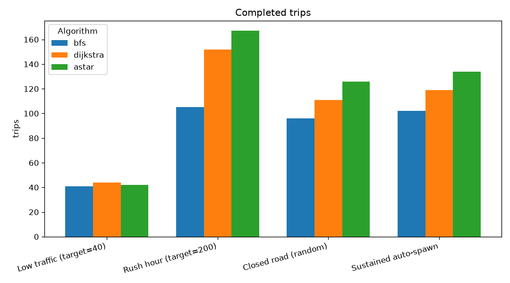
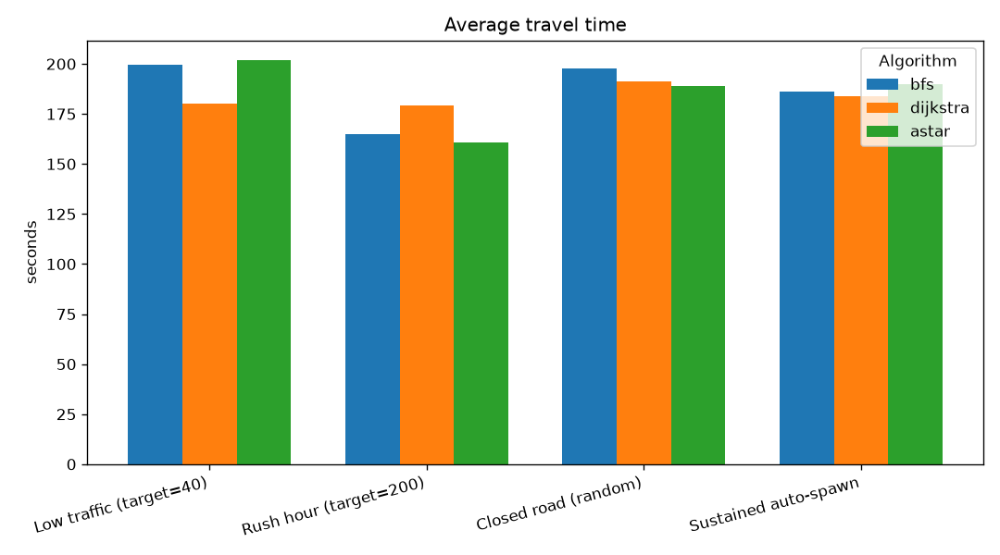
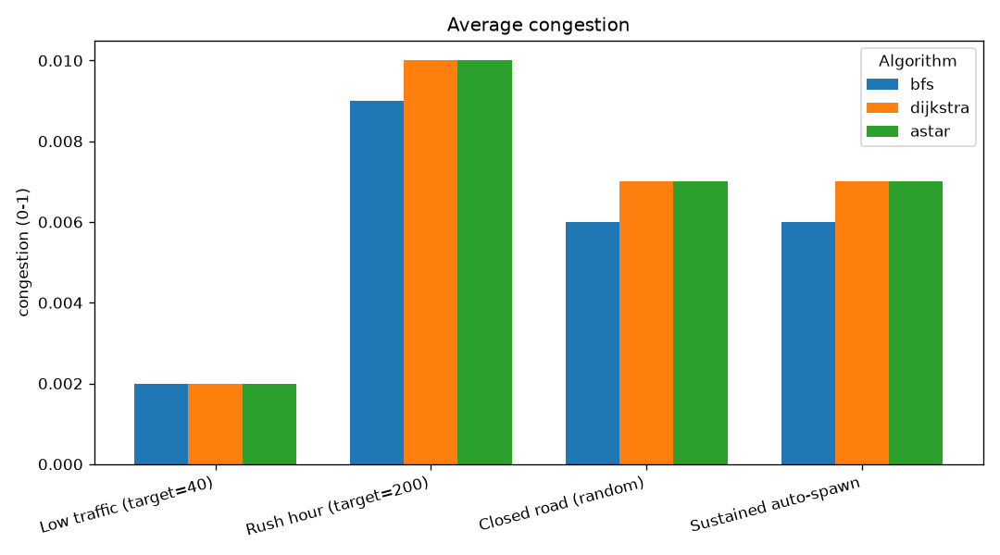
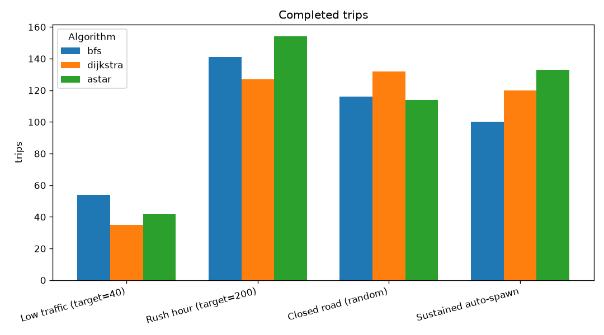
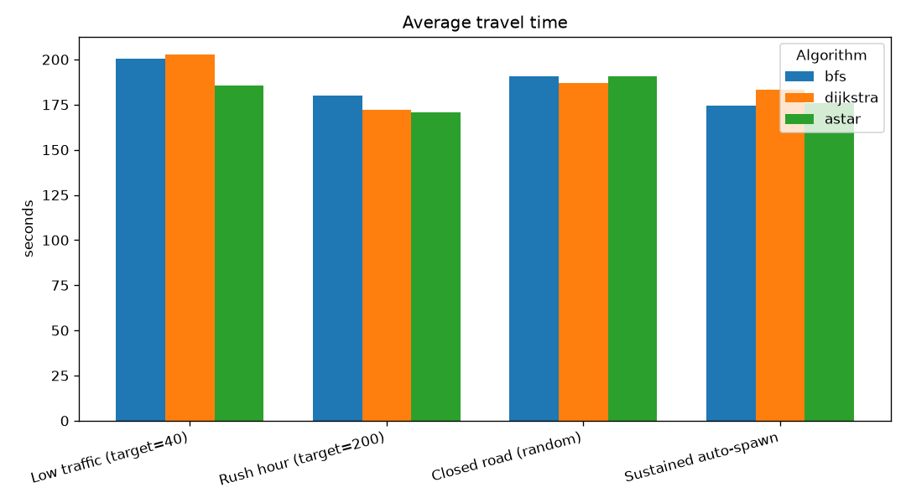
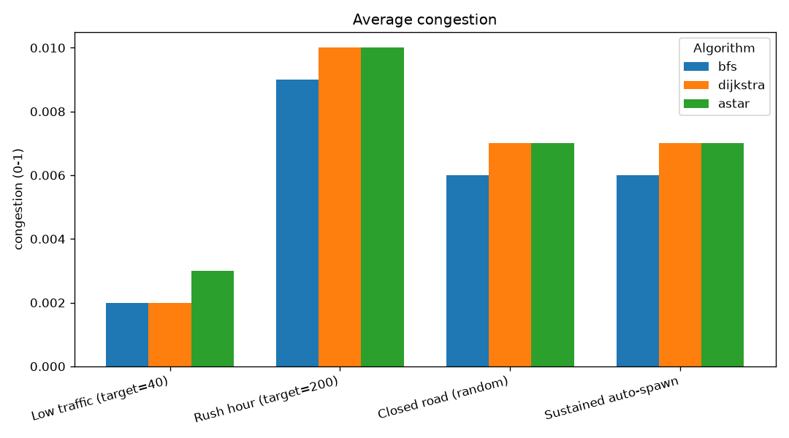
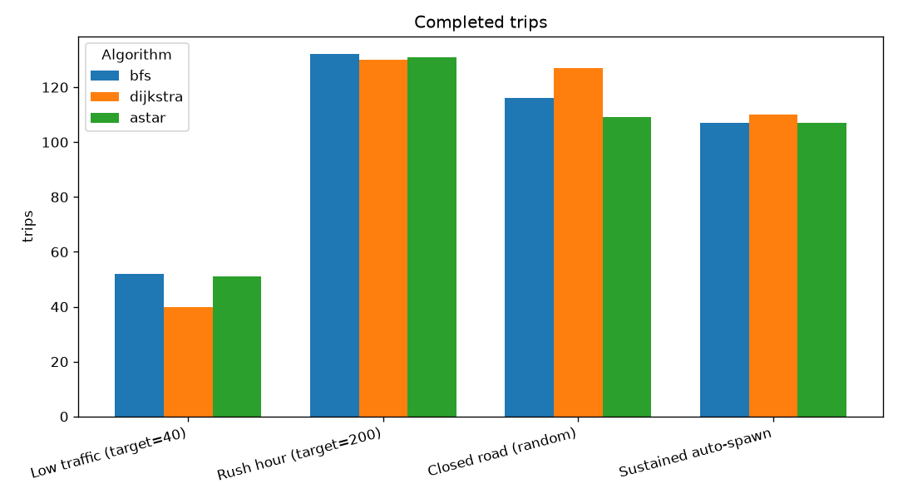
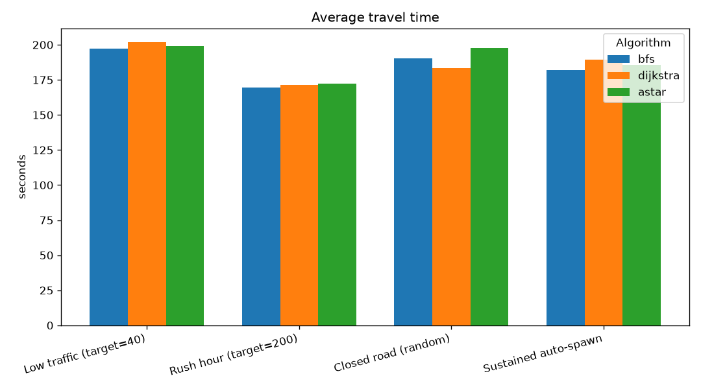
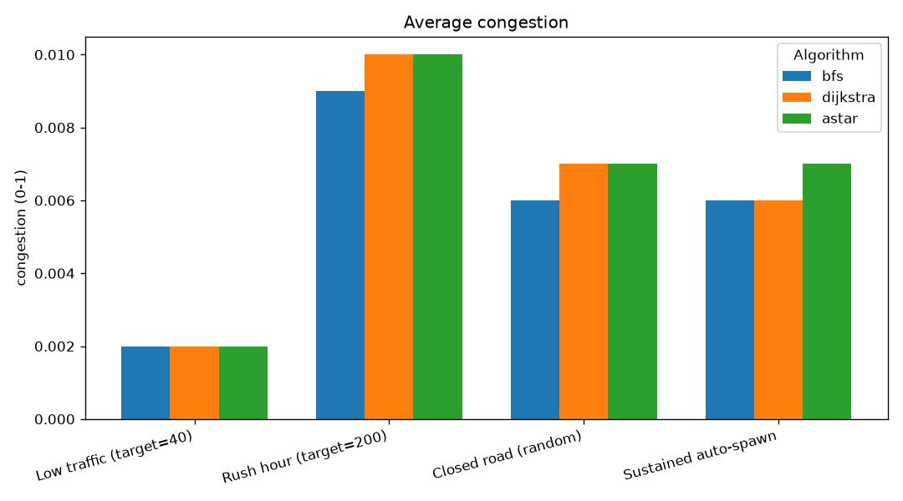

# Output from tools/route_bench.cpp:
```
[map] pruned 202 node(s) outside the largest connected road network (kept 2617)
[map] signalized 3 junction(s) from OSM traffic_signals (9 skipped: nothing to arbitrate)
map           : data\maps\small_map.geojson
graph         : 2617 intersections, 6097 roads
pairs         : 100 attempted, 100 solved by all three

Algorithm    Solved  Nodes/route    Time (us)     Route cost      Roads
----------   ------  -----------    ---------     ----------      -----
BFS             100       1406.5        926.6         1579.4       36.0
Dijkstra        100       1385.4       1581.9         1410.6       41.6
A*              100        377.9       1069.0         1410.6       41.6

--- What the table shows ---
A* == Dijkstra cost : 100 / 100 pairs   (admissible heuristic => optimal)
A* search effort    : 27.3% of Dijkstra's nodes
BFS route cost      : 112.0% of Dijkstra's   (more expensive: BFS counts roads, not weight)
```
- Note that us here means microseconds.
- Explaination : #TODO


## 2026-08-01 22:25

Four scenarios x three algorithms; each run advanced 300 s of simulated time (x10 speed). Closure picks a random road each run.

### Results

| Scenario | Algorithm | Trips | Avg travel (s) | Avg congestion | Recomputes | Active end |
|---|---|---|---|---|---|---|
| Low traffic (target=40) | bfs | 41 | 199.4 | 0.002 | 400 | 40 |
| Low traffic (target=40) | dijkstra | 44 | 180.03 | 0.002 | 366 | 40 |
| Low traffic (target=40) | astar | 42 | 201.7 | 0.002 | 402 | 40 |
| Rush hour (target=200) | bfs | 105 | 165.11 | 0.009 | 1191 | 200 |
| Rush hour (target=200) | dijkstra | 152 | 179.26 | 0.01 | 1998 | 198 |
| Rush hour (target=200) | astar | 167 | 160.74 | 0.01 | 1947 | 199 |
| Closed road (random) | bfs | 96 | 197.74 | 0.006 | 963 | 120 |
| Closed road (random) | dijkstra | 111 | 191.49 | 0.007 | 1421 | 120 |
| Closed road (random) | astar | 126 | 188.77 | 0.007 | 1571 | 120 |
| Sustained auto-spawn | bfs | 102 | 186.23 | 0.006 | 945 | 120 |
| Sustained auto-spawn | dijkstra | 119 | 183.79 | 0.007 | 1443 | 120 |
| Sustained auto-spawn | astar | 134 | 189.91 | 0.007 | 1313 | 119 |

### Charts








## 2026-08-01 22:39

Four scenarios x three algorithms; each run advanced 300 s of simulated time (x10 speed). Closure picks a random road each run.

### Results

| Scenario | Algorithm | Trips | Avg travel (s) | Avg congestion | Recomputes | Active end |
|---|---|---|---|---|---|---|
| Low traffic (target=40) | bfs | 54 | 200.38 | 0.002 | 285 | 38 |
| Low traffic (target=40) | dijkstra | 35 | 202.56 | 0.002 | 274 | 40 |
| Low traffic (target=40) | astar | 42 | 185.64 | 0.003 | 322 | 40 |
| Rush hour (target=200) | bfs | 141 | 180.09 | 0.009 | 1580 | 200 |
| Rush hour (target=200) | dijkstra | 127 | 171.98 | 0.01 | 1795 | 200 |
| Rush hour (target=200) | astar | 154 | 170.67 | 0.01 | 1879 | 200 |
| Closed road (random) | bfs | 116 | 190.73 | 0.006 | 956 | 120 |
| Closed road (random) | dijkstra | 132 | 187.11 | 0.007 | 1330 | 120 |
| Closed road (random) | astar | 114 | 190.66 | 0.007 | 1188 | 118 |
| Sustained auto-spawn | bfs | 100 | 174.52 | 0.006 | 1106 | 120 |
| Sustained auto-spawn | dijkstra | 120 | 183.07 | 0.007 | 978 | 120 |
| Sustained auto-spawn | astar | 133 | 176.03 | 0.007 | 1238 | 119 |

### Charts








## 2026-08-01 23:29

Four scenarios x three algorithms; each run advanced 300 s of simulated time (x10 speed). Closure picks a random road each run.

### Results

| Scenario | Algorithm | Trips | Avg travel (s) | Avg congestion | Recomputes | Active end |
|---|---|---|---|---|---|---|
| Low traffic (target=40) | bfs | 52 | 197.17 | 0.002 | 327 | 40 |
| Low traffic (target=40) | dijkstra | 40 | 201.67 | 0.002 | 442 | 40 |
| Low traffic (target=40) | astar | 51 | 199.18 | 0.002 | 370 | 40 |
| Rush hour (target=200) | bfs | 132 | 169.43 | 0.009 | 1605 | 199 |
| Rush hour (target=200) | dijkstra | 130 | 171.17 | 0.01 | 1908 | 198 |
| Rush hour (target=200) | astar | 131 | 172.3 | 0.01 | 1675 | 196 |
| Closed road (random) | bfs | 116 | 190.1 | 0.006 | 954 | 120 |
| Closed road (random) | dijkstra | 127 | 183.43 | 0.007 | 1106 | 119 |
| Closed road (random) | astar | 109 | 197.8 | 0.007 | 1190 | 120 |
| Sustained auto-spawn | bfs | 107 | 181.83 | 0.006 | 1313 | 120 |
| Sustained auto-spawn | dijkstra | 110 | 189.28 | 0.006 | 1310 | 120 |
| Sustained auto-spawn | astar | 107 | 185.5 | 0.007 | 981 | 120 |

### Charts








