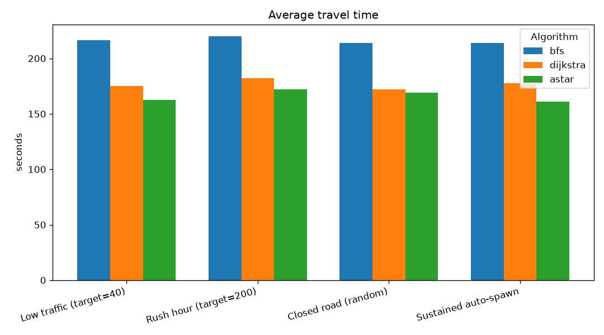
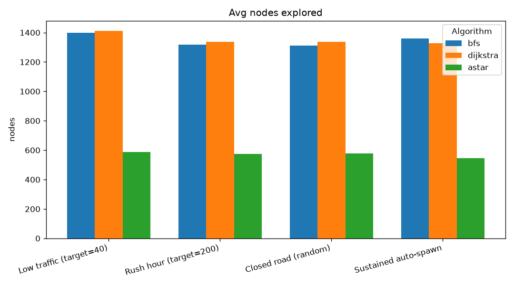
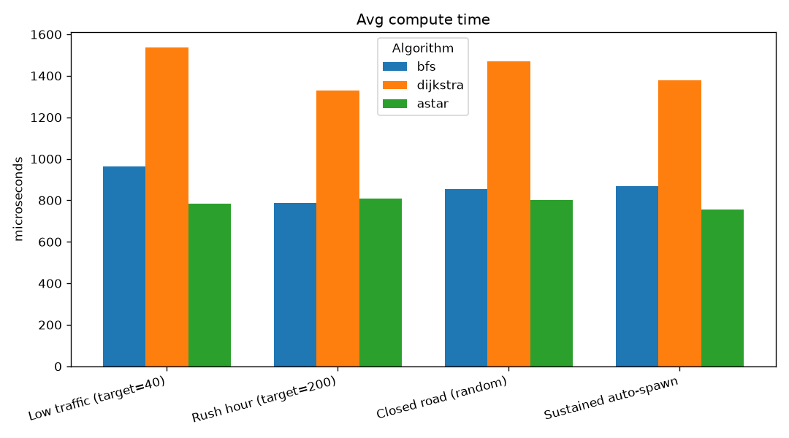
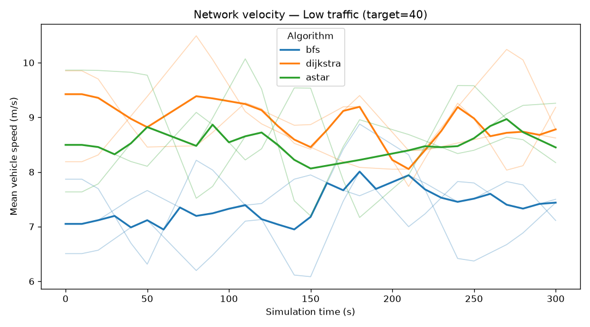
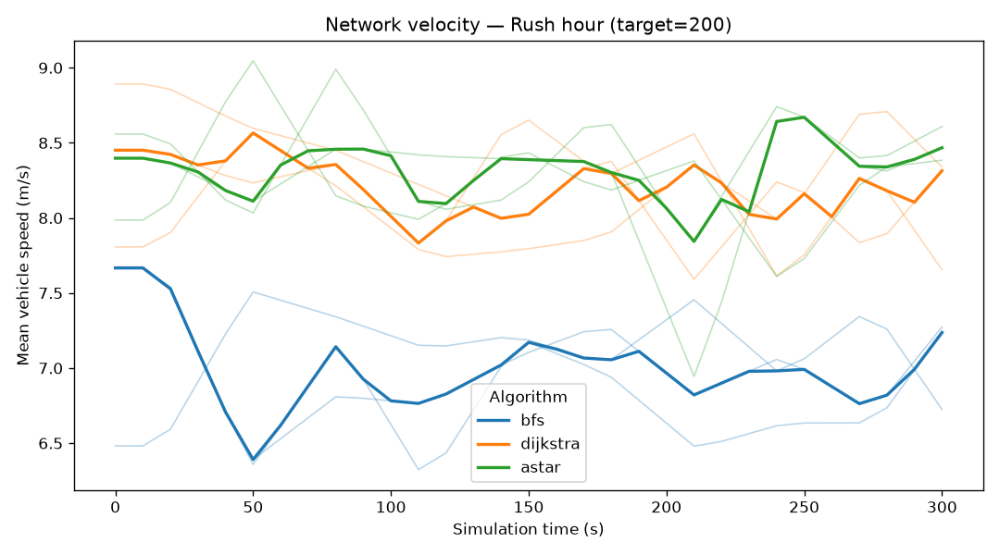
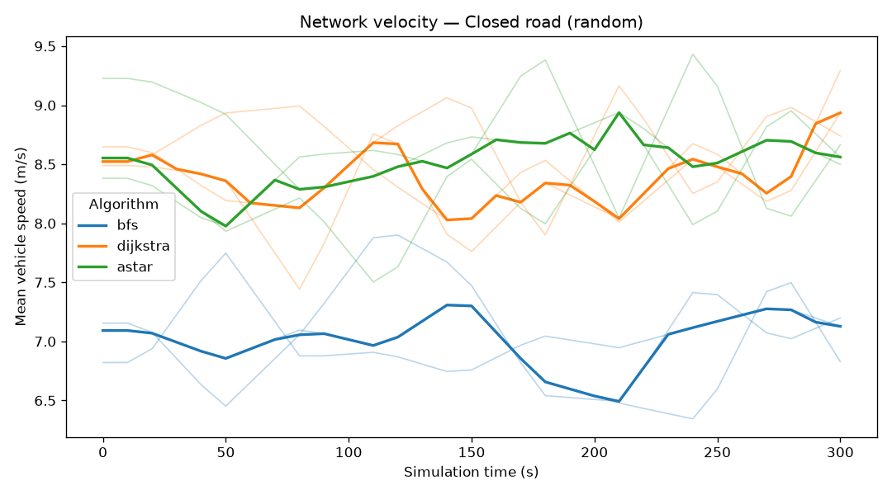
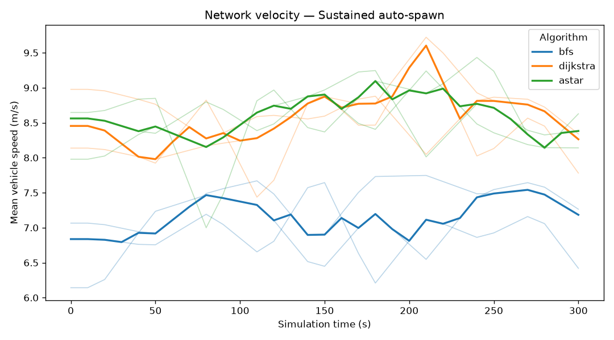

# Output from tools/route_bench.cpp:
```
[map] pruned 202 node(s) outside the largest connected road network (kept 2617)
[map] signalized 3 junction(s) from OSM traffic_signals (9 skipped: nothing to arbitrate)
map           : data\maps\small_map.geojson
graph         : 2617 intersections, 6097 roads
pairs         : 100 attempted, 100 solved by all three

Algorithm    Solved  Nodes/route    Time (us)     Route cost      Roads
----------   ------  -----------    ---------     ----------      -----
BFS             100       1406.5        450.3          157.8       36.0
Dijkstra        100       1363.8        672.2          116.8       42.0
A*              100        518.7        405.5          116.8       42.0

--- What the table shows ---
A* == Dijkstra cost : 100 / 100 pairs   (admissible heuristic => optimal)
A* search effort    : 38.0% of Dijkstra's nodes
BFS route cost      : 135.1% of Dijkstra's   (more expensive: BFS counts roads, not weight)
```

## 2026-08-03 16:06

Four scenarios x three algorithms (3 repeats per combo, mean ± range); each run advanced 300 s of simulated time (x10 speed) after a warm-up, routing by time cost. Closure picks a random road each run.

### Results

| Scenario | Algorithm | Trips/min | Travel (s) | Congestion | Recomp/min | Active | Nodes/recomp | Micros/recomp | Vel (m/s) |
|---|---|---|---|---|---|---|---|---|---|
| Low traffic (target=40) | bfs | 11.383 ± 1.81 | 216.223 ± 53.67 | 0.001 | 11.513 ± 2.2 | 40.0 | 1398.267 ± 164.1 | 961.833 ± 218.7 | 7.013 ± 0.58 |
| Low traffic (target=40) | dijkstra | 13.723 ± 1.95 | 174.95 ± 51.64 | 0.001 | 13.79 ± 2.15 | 40.0 | 1410.167 ± 126.0 | 1535.233 ± 47.7 | 8.713 ± 1.09 |
| Low traffic (target=40) | astar | 14.273 ± 0.8 | 162.697 ± 22.81 | 0.001 | 14.273 ± 0.8 | 40.0 | 588.9 ± 60.6 | 784.267 ± 60.3 | 8.86 ± 0.56 |
| Rush hour (target=200) | bfs | 53.63 ± 1.15 | 219.737 ± 20.29 | 0.005 | 54.213 ± 0.95 | 200.0 | 1319.333 ± 24.4 | 785.933 ± 18.7 | 7.027 ± 0.54 |
| Rush hour (target=200) | dijkstra | 67.637 ± 4.78 | 182.153 ± 33.05 | 0.005 | 68.157 ± 4.98 | 200.0 | 1337.2 ± 106.5 | 1329.333 ± 77.5 | 8.163 ± 0.39 |
| Rush hour (target=200) | astar | 71.077 ± 4.13 | 172.0 ± 6.68 | 0.005 | 72.317 ± 3.94 | 200.0 | 573.767 ± 45.8 | 807.033 ± 15.9 | 8.29 ± 0.19 |
| Closed road (random) | bfs | 32.243 ± 1.12 | 213.9 ± 6.92 | 0.003 | 32.307 ± 1.31 | 120.0 | 1311.833 ± 34.7 | 854.767 ± 18.0 | 6.59 ± 0.37 |
| Closed road (random) | dijkstra | 43.3 ± 2.74 | 172.077 ± 19.92 | 0.003 | 43.43 ± 2.35 | 120.0 | 1338.2 ± 71.0 | 1470.133 ± 224.4 | 8.06 ± 1.06 |
| Closed road (random) | astar | 42.107 ± 3.06 | 169.197 ± 10.23 | 0.003 | 42.3 ± 2.48 | 120.0 | 578.3 ± 29.1 | 800.733 ± 72.3 | 8.567 ± 0.31 |
| Sustained auto-spawn | bfs | 33.013 ± 2.54 | 213.973 ± 38.85 | 0.003 | 33.273 ± 2.34 | 120.0 | 1361.433 ± 138.3 | 869.767 ± 109.4 | 7.17 ± 0.45 |
| Sustained auto-spawn | dijkstra | 42.91 ± 2.3 | 177.65 ± 12.96 | 0.003 | 43.303 ± 2.5 | 120.0 | 1325.967 ± 77.0 | 1377.233 ± 145.1 | 8.297 ± 0.52 |
| Sustained auto-spawn | astar | 44.96 ± 0.8 | 161.077 ± 5.53 | 0.003 | 45.22 ± 1.0 | 120.0 | 546.967 ± 102.3 | 755.967 ± 130.2 | 8.607 ± 0.11 |

### Charts









### Velocity over time






